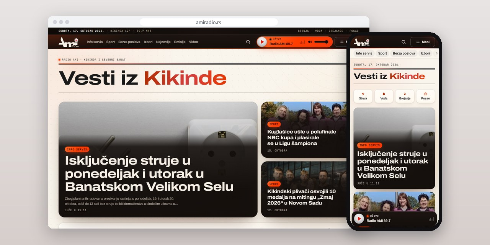
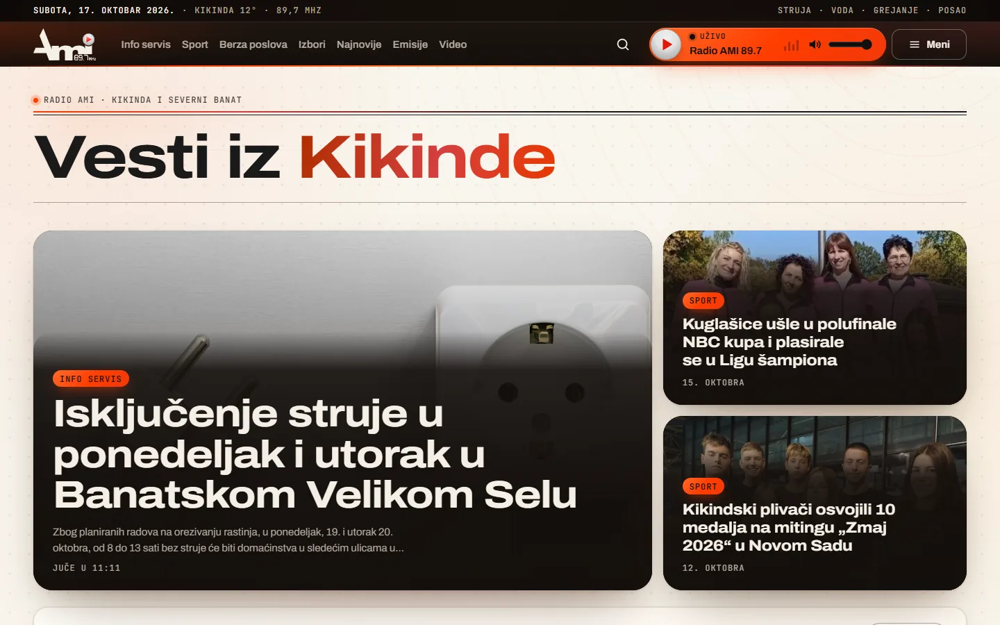
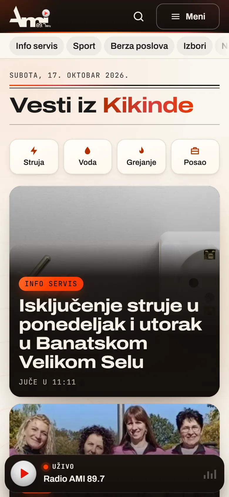
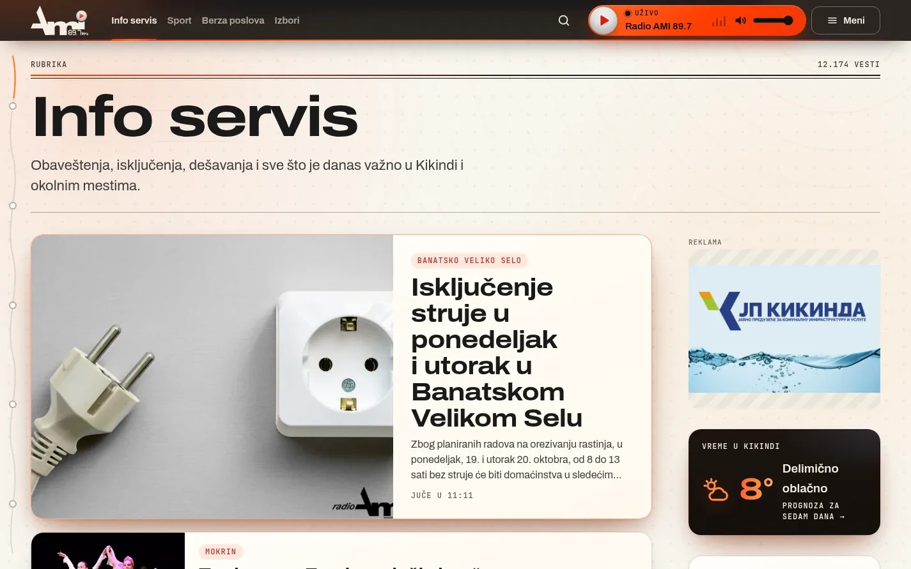
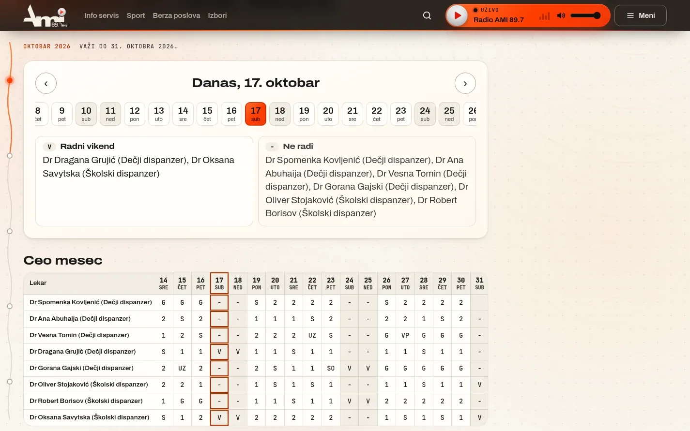

# Radio AMI

Portal radija iz Kikinde: 15.029 vesti prenetih sa WordPressa, plejer uživo koji ne staje pri prelasku sa strane na stranu i info servis.

**[amiradio.rs](https://www.amiradio.rs/)** · [Studija slučaja](https://svilenkovic.rs/radovi/radio-ami) · [English](README.md)

> [!NOTE]
> Klijentski projekat. Izvorni kod pripada klijentu i čuva se u privatnom repozitorijumu. Ova stranica opisuje šta sam uradio i kako.

<table>
  <tr><td><b>Klijent</b></td><td>Reks DOO Kikinda, Radio AMI 89,7</td></tr>
  <tr><td><b>Delatnost</b></td><td>Lokalni radio i portal vesti</td></tr>
  <tr><td><b>Lokacija</b></td><td>Kikinda</td></tr>
  <tr><td><b>Vrsta</b></td><td>Portal radija sa panelom za redakciju (PWA)</td></tr>
  <tr><td><b>Moj deo posla</b></td><td>Redizajn, izrada, selidba, hosting i održavanje</td></tr>
  <tr><td><b>Tehnologije</b></td><td>PHP 8.3, MariaDB, Redis, Icecast, nginx, PWA</td></tr>
</table>

## O projektu

Radio AMI emituje program iz Kikinde na 89,7 MHz i objavljuje vesti iz grada i okolnih mesta. Stari sajt je bio na WordPressu i imao je više od petnaest hiljada vesti. Radiju je trebao brži portal koji zadržava svaku od njih, čuva stare linkove i uz vesti stavlja ono što čitaoci iz Kikinde traže svaki dan: isključenja struje i vode, oglase za posao i raspored lekara.

Portal sam napisao u čistom PHP-u 8.3, sa MariaDB bazom i Redis kešom, bez WordPressa i bez dodataka, i preneo 15.029 vesti sa slikama, rubrikama i datumima. Za 1.348 starih adresa postoji trajno preusmerenje na nove, pa link podeljen na društvenim mrežama pre nekoliko godina i dalje otvara istu vest. Plejer uživo stoji u zaglavlju i ne staje kad čitalac otvori drugu stranu, a strim ide preko Icecast releja na mom serveru.

## Šta sam uradio

- 15.029 vesti i 1.348 starih adresa preneto sa WordPressa, uz trajna preusmerenja
- Plejer uživo u zaglavlju koji ne staje pri prelasku sa strane na stranu, Icecast relej i liste M3U i PLS
- Info servis za struju, vodu, grejanje i posao, uz repertoar pozorišta i mesečni raspored lekara koji se otvara po danu
- Poseban panel za redakciju koji se instalira kao zasebna aplikacija, sa reklamama i brojem prikaza i klikova za svaki baner
- Javni deo kao aplikacija sa strane /aplikacija/, newsletter sa dvostrukom potvrdom i strane za emisije i video
- Mobilni PageSpeed 95, a pristupačnost, dobre prakse i SEO 100, izmereno 17. oktobra 2026.

## Merenja

| | Performanse | Pristupačnost | Dobre prakse | SEO |
| :-- | :-: | :-: | :-: | :-: |
| Telefon | 95 | 100 | 100 | 100 |
| Desktop | 99 | 100 | 100 | 100 |

PageSpeed Insights, laboratorijsko merenje živog sajta, oktobar 2026. Sigurnosna zaglavlja: 6 od 6. axe provera pristupačnosti: bez prekršaja. Strukturisani podaci: `BroadcastService`, `NewsMediaOrganization`, `RadioStation`.

## Snimci ekrana

<table>
  <tr>
    <td width="68%" valign="top"></td>
    <td width="32%" valign="top"></td>
  </tr>
</table>

Info servis sa najnovijim obaveštenjem, reklamom i vremenom u Kikindi

Raspored rada lekara: izbor dana i tabela za ceo mesec

---

Izrada: [D. Svilenković](https://svilenkovic.rs).
